# El esquema de MalphasOS, hoy

**Esta nota existe porque no había ninguna que describiera esta base de datos.** Las dos de este
directorio —[[esquema-bd-v4]] y [[evolucion-esquema-v1-v4]]— describen el esquema del **sistema
original**, generado con Enterprise Architect, y la primera se anuncia como «el esquema PostgreSQL
**actual**»: era cierto cuando se escribió y dejó de serlo al construirse MalphasOS. Quien preguntaba
«cómo tenemos la base de datos» aterrizaba ahí y leía las 27 tablas del sistema viejo.

**Coincidencia que conviene no confundir**: el original tenía **27** tablas y MalphasOS tenía **26** el
día que se escribió esta nota. No eran las mismas menos una; es otro modelo con un número parecido.
(Esta frase decía «tiene **26**» en presente: **falso desde `V12`**, el 2026-10-04, y nadie la tocó en
seis recuentos. Hoy son **33**; la cifra viva está en «Las cifras», más abajo.)

## Cómo se hizo esta nota, y cómo se vuelve a hacer

> **Corregido el 2026-10-04, y la corrección es sobre esta misma sección.** Decía, sin matizar, que la
> nota estaba «generada leyendo la base de datos en marcha, no las migraciones ni la memoria». Era
> **verdad a medias**: la lista de tablas y el grafo de foráneas sí se leyeron de `information_schema`,
> y **los nombres de columna se escribieron de memoria**. Al revisarla al día siguiente aparecieron
> **doce columnas que no existen** en seis tablas, más una llave primaria inventada en `encargado`:
>
> - `pais.n_codigo_iso` era `k_codigo_iso` —`k_` porque es llave natural—.
> - `persona` tenía cuatro nombres falsos: su llave primaria es **subrogada** y el documento vive en
>   `k_cedula`, no al contrario; y los nombres van en cuatro columnas, no en dos.
> - `cliente.n_nit` **no existe**: es `k_documento` más `n_tipo_identificacion`, porque el documento de
>   un cliente puede no ser un NIT.
> - `encargado` **no tiene identificador propio**: su llave primaria es la de la persona.
> - `orden_trabajo` tenía tres nombres mal, entre ellos la fecha.
>
> **Un diagrama con nombres plausibles y falsos es peor que no tener diagrama**, porque se cita. Y la
> lección no es «mirar mejor»: es que la parte verificada y la inventada iban en la misma nota sin
> distinguirse. Por eso ahora hay un guion que lo comprueba —ver abajo— y por eso esta sección dice qué
> se leyó y qué no.

**Lo que sí se lee de la base**: la lista de tablas, el grafo de foráneas y los conteos. Las migraciones
son once archivos y el estado final no se ve en ninguno; `information_schema` sí lo ve. Las consultas, y
**se recalculan antes de citarlas**:

```sql
-- tablas (sin flyway_schema_history)
SELECT count(*) FROM information_schema.tables
WHERE table_schema = 'public' AND table_type = 'BASE TABLE'
  AND table_name <> 'flyway_schema_history';

-- foraneas, y el grafo entero
SELECT tc.table_name, kcu.column_name, ccu.table_name AS apunta_a, tc.constraint_name
FROM information_schema.table_constraints tc
         JOIN information_schema.key_column_usage kcu ON kcu.constraint_name = tc.constraint_name
         JOIN information_schema.constraint_column_usage ccu ON ccu.constraint_name = tc.constraint_name
WHERE tc.constraint_type = 'FOREIGN KEY' AND tc.table_schema = 'public';
```

### El guion que comprueba que las columnas existen

`SecondBrain/herramientas/verificar-esquema.py` recorre los diagramas de abajo y exige que cada columna
dibujada exista en la base. Con los contenedores arriba, desde la raíz del repositorio:

```bash
docker compose exec -T postgres psql -U malphasos -d malphasos_db -t -A -F'|' \
  -c "SELECT table_name, column_name FROM information_schema.columns \
      WHERE table_schema='public' AND table_name <> 'flyway_schema_history';" \
  | python3 SecondBrain/herramientas/verificar-esquema.py
```

Devuelve 0 si todo cuadra y 1 nombrando lo que sobra. **Se vio fallar** cambiando `k_cedula` por
`n_cedula`, que es lo que este proyecto exige de una comprobación.

**No comprueba tipos ni marcas `PK`/`FK`**, y eso hay que saberlo: la llave primaria inventada de
`encargado` no la habría cazado. Caza la clase de error que de hecho se cometió —nombres de columna— y
lo demás sigue dependiendo de leer el diagrama contra `\d tabla`.

## Las cifras, medidas el 2026-10-27 y recontadas el 2026-11-02 sobre `V56` —`V57` no las mueve—

| | |
|---|---|
| Migraciones aplicadas | **57** (`V1`…`V57`): la refactorización a 3FN acabó en `V52`, `V53` puso al supervisor del cliente, `V54` la aprobación de la orden, `V55` a quien recibe como persona registrada, `V56` en cascada las foráneas hacia `persona` y `V57` el voltaje decimal del modelo, que rehace su `CHECK` sin cambiar la cuenta. Decía **56** hasta el 2026-11-07 |
| Tablas de dominio | **35** — eran **34** hasta `V54`, **36** hasta `V53`, **37** hasta `V52` y **38** hasta `V50` |
| Llaves foráneas | **48**, de las cuales **1 compuesta**, y **8 con `ON UPDATE CASCADE`** —las que apuntan a `persona`, desde `V56`; ninguna antes— — eran **47** hasta `V55`, **43** hasta `V54`, **47** hasta `V53`, **50** hasta `V52`, y **52** y **2** compuestas hasta `V50` |
| Restricciones `CHECK` propias | **70** — eran **69** hasta `V53`, **73** hasta `V52`, **77** hasta `V51` y **76** hasta `V49` |
| Restricciones de exclusión | **1** — el correo de la cuenta, de `V40` |
| Triggers propios | **2** — los primeros del esquema, desde `V19` y `V20` |
| Índices únicos **parciales** | **11** — eran **10** hasta `V54`, **9** hasta `V51` y **10** hasta `V48` |
| Foráneas sin ningún índice que las encabece | **0** desde `V52`, que quitó la última con su tabla, `intervencion` — eran **13** antes de `V42`, **3** después, y `V47` y `V48` quitaron una cada una |
| Tablas con borrado lógico | **31 de 35** — ya no es universal: `empresa`, `telefono_empresa`, `firma_persona` e `imagen_documento` no lo llevan |

> **Recontado el 2026-10-27 sobre la base con `V41`**, con las consultas de arriba más `pg_constraint` y
> `pg_index`. **La tabla anterior llevaba caducada desde `V36`, el 2026-10-17**: la versión 1.0.0 añadió
> nueve migraciones y nadie volvió a contar. Las cifras de entonces no se desglosan aquí migración por
> migración —sería reconstruirlas, no medirlas—; lo medido es el total de hoy y el paso de `V41`:
>
> - `V41`, **un encargado con varias sedes y áreas**: sale `encargado` —una tabla, tres foráneas, dos
>   `CHECK`— y entran `encargado_sede` y `encargado_area`, con dos foráneas cada una y **llave
>   compuesta**. Son **+1 tabla, +1 foránea, −2 `CHECK`**: los dos `CHECK` ataban el tipo a la columna
>   llena, y el tipo ahora es la tabla. Ver la sección de `client`.
>
> **Y una afirmación de esta tabla era falsa desde `V36`**: decía «borrado lógico en 33 de 33,
> universal, sin excepción». Las tres tablas de la versión 1.0.0 no lo llevan, y con razón: `empresa` es
> una sola fila que se edita, la firma de una persona se sustituye, y una imagen de documento se guarda
> una vez por su huella y nunca se retira. Corregido el 2026-10-27.
>
> - `V42`, **la primera de la refactorización** —ver `Documentation/DatabaseDesign/analisis-2026-10-27.md`—,
>   **no cambia las cifras de arriba** salvo una fila nueva: nueve índices para diez de las trece foráneas
>   que no tenían ninguno, los dueños de `correo_persona` y `telefono_persona` obligatorios, y tres
>   nombres que engañaban —`orden_trabajo.k_identificador` es `k_id_ingeniero`,
>   `reporte_servicio.t_finalizado` es `f_finalizado` y `firma_persona.k_id_persona` es
>   `k_identificador`—. Que toda foránea tenga su índice lo exige desde ese día
>   `ForeignKeyIndexContractTest`, con las tres que se van como excepciones con nombre.
> - `V43`, **los teléfonos de la empresa en su tabla**: `empresa.t_telefonos` era un arreglo, la única
>   columna así del esquema. Entra `telefono_empresa` —**+1 tabla, +1 foránea, +2 `CHECK`**—, sin
>   identificador propio ni borrado lógico porque es una lista de valores que se reescribe entera. Ver
>   la sección de `company`, que **esta nota no tenía**: `empresa` entró con `V36`, el 2026-10-17, y
>   nadie la dibujó. Corregido el 2026-10-27.
> - `V44`, **la ciudad de la empresa, del catálogo**: `n_ciudad` era texto libre y pasa a `k_id_ciudad`,
>   con su foránea y su índice —**+1 foránea**; el `CHECK` de los textos se rehace sin la ciudad y el
>   total no cambia—. La que estaba escrita se enlaza por nombre, sin tildes ni mayúsculas, y si no casa
>   con una sola ciudad la migración **se detiene diciendo cuál**: la decisión de `V10`.
> - `V45`, **el logo y las firmas, por huella**: `empresa.b_logo` con su tipo y `firma_persona.b_imagen`
>   pasan a `imagen_documento`, una vez por versión, y sus filas guardan la huella —**+2 foráneas, −2
>   `CHECK`**: el del logo con su tipo y el del tamaño de la firma, que comprueba el dominio—. Ninguna
>   imagen se borra al cambiarla, porque un informe congelado puede apuntarla. Ver las secciones de
>   `person` y `shared`, que **esta nota no tenía**: `firma_persona` e `imagen_documento` entraron con
>   `V37` y `V38`, el 2026-10-17, y nadie las dibujó. Corregido el 2026-10-27.
> - `V46`, **sin segundo tipo de persona**: `persona.t_segundo_tipo_persona` y su `CHECK` salen —**−1
>   `CHECK`**—. Es encargado quien tiene asignaciones; y si alguien que no es encargado ni representante
>   las tuviera, la migración se detiene diciendo cuántos.
> - `V47`, **la orden llega a su cliente por la sede**: sale `orden_trabajo.k_id_cliente` con su foránea,
>   la compuesta (sede, cliente) y la restricción única de `sede` que solo existía para ella —**−1
>   foránea neta, −1 compuesta, −1 única**—. El código sigue leyendo el cliente de la orden, a través de
>   su sede, con un `@Formula`.
> - `V48`, **la verificación llega a su magnitud por la unidad**: sale `verificacion_tipo_equipo.k_id_magnitud`
>   con la compuesta (magnitud, unidad), el índice único parcial «una magnitud activa por tipo» y la
>   restricción única de `unidad_medida` que solo existía para la compuesta; entra una foránea simple a la
>   unidad, con su índice —**−1 compuesta, −1 única, −1 parcial**, las foráneas se quedan en 52—. La
>   regla de una magnitud por tipo queda solo en el agregado `EquipmentType`, que ya la imponía.
> - `V49`, **la orden se congela al ejecutarse**: `orden_trabajo` gana `t_documento` (`jsonb`) y
>   `b_documento_tardio`, con un `CHECK` que exige el documento a toda ejecutada y lo prohíbe a las demás
>   —**+1 `CHECK`**—. Las ya ejecutadas se congelan en SQL dentro de la misma migración, con el área que
>   guardó el puente, y quedan como tardías. Es la primera migración con un **gemelo en Java**
>   comprobado: una prueba ejecuta su sentencia y la compara con lo que compone `WorkOrderDocumentComposer`.
> - `V50`, **sin tabla puente**: sale `orden_trabajo_equipo` —una tabla y sus tres foráneas, la del área
>   incluida— y con ella la compuesta del reporte contra el puente, que cambia por dos simples a la orden y
>   al equipo, cuyos índices ya existían —**−1 tabla, −2 foráneas netas, −1 compuesta**—. Un equipo está en
>   una orden si y solo si tiene en ella un reporte activo, así que antes de quitarla la migración da su
>   borrador a cada equipo del puente sin reporte: en desarrollo fueron cinco, con sus pasos del protocolo
>   los preventivos. Se recontó con el guion de abajo, que **falló** hasta quitar el puente del diagrama.
> - `V52`, **sin `intervencion`**: el historial de la hoja de vida sale de los reportes cerrados, una línea
>   por par (orden, equipo) —la de su último cierre, que es la regla de `V14` convertida en filtro—. Salen
>   la tabla, sus tres foráneas —la del equipo, redundante con la del reporte, y la autorreferencia
>   `k_id_reemplazada_por`, **el único ciclo dirigido del esquema**—, sus cuatro `CHECK` y su única de una
>   línea por reporte; entra `IX_reporte_servicio_equipo_cierre`, el último cierre de cada equipo para el
>   listado —**−1 tabla, −3 foráneas, −4 `CHECK`, −1 única**—. No se rellena nada: lo quitado era una copia. El
>   guion **falló** con sus 10 columnas hasta quitarlas del diagrama.
> - `V51`, **el reporte cerrado vive en su documento**: salen las copias del catálogo —las 11 columnas de
>   la ficha en `patron_verificacion_reporte`, la unidad y la tolerancia en `dato_verificacion`, y el
>   texto y la posición en `paso_reporte`— con los cuatro `CHECK` que las vigilaban y la única de la
>   posición, `UQ_paso_reporte_orden`; entra `UQ_paso_reporte_protocolo`, parcial —**−17 columnas, −4
>   `CHECK`, −1 única, +1 parcial**—. Antes, los documentos de los cerrados pasan a la versión 2 leyendo
>   esas copias, y la migración **se detiene** si queda un cerrado sin documento. El guion **falló** con las
>   17 columnas hasta quitarlas del diagrama.

> **Recontado el 2026-10-16, por la noche, sobre la base con `V32`**, con las mismas consultas. Las cinco
> migraciones del formato del reporte —el que la empresa ya entrega, ver [[dominio-reporte-servicio]]—
> traen:
>
> - `V28`, el **número del reporte**: los seis primeros caracteres de su identificador, como un commit
>   de git. Un índice único **sobre una expresión** —`left(k_id_reporte_servicio::text, 6)`— y **no
>   parcial**, a propósito: un reporte retirado conserva su número y otro no puede heredarlo. No cuenta
>   entre los parciales.
> - `V29`, la **ficha del patrón**: seis columnas opcionales en `equipo_patron` —modelo, código interno,
>   rango, resolución, fecha de calibración y empresa calibradora— con **seis `CHECK`**: cinco de «no en
>   blanco» y uno de que la calibración no sea posterior al vencimiento.
> - `V30`, **varios patrones por verificación**: la tabla `patron_verificacion_reporte`, con **tres
>   foráneas**, un `CHECK` y el **noveno índice parcial**. Y **deshace `V27`**: el patrón pasa a cada
>   verificación de la que el reporte tiene lecturas, y las seis columnas, la foránea y el `CHECK` de
>   todo o nada salen de `reporte_servicio`. Es la tercera migración que mueve datos, tras `V10` y `V15`.
> - `V31`, **el ingreso y la entrega**: siete columnas en `reporte_servicio` con **cuatro `CHECK`** —tres
>   escritos con `CASE`— y la tabla `accesorio_reporte`, con una foránea y **tres `CHECK`**. **Sin índice
>   único sobre el orden**, y es la primera tabla con orden que lo deja fuera a propósito: la lista se
>   sustituye entera, y retirar e insertar en el mismo vaciado chocaría con él.
> - `V32`, el **formato del reporte** en `tipo_equipo`: obligatorio, con `DEFAULT 'MP0'` y un `CHECK`.
>   El `DEFAULT` lo exigieron **ocho clases de prueba** que insertan tipos con SQL.
>
> Antes: 27 migraciones, 31 tablas, 43 foráneas, 54 `CHECK`, 8 parciales. Las cuentas cuadran: +3 +1 −1
> foráneas, +6 +1 +4 +3 +1 −1 `CHECK`. El guion de columnas da **211 dibujadas, todas existentes**
> —eran 180—: las treinta y una de las tablas y columnas nuevas, menos las seis de `V27` que se fueron.

> **Recontado el 2026-10-16, sobre la base con `V27`**, leyendo `pg_constraint` y `pg_index`. Las cuatro
> migraciones de la primera versión funcional —ver [[hoja-de-ruta-producto]]— traen:
>
> - `V24`, la causa y los repuestos del **correctivo**: dos columnas de texto en `reporte_servicio`, **sin
>   ningún `CHECK`**. Es una incoherencia que este recuento destapó: sus cuatro hermanas de texto
>   —falla, diagnóstico, procedimientos y observaciones— llevan `CHECK (… IS NULL OR btrim(…) <> '')` y
>   estas dos no. El dominio normaliza el blanco a nulo, así que por la API no entra; por SQL sí.
>   Anotada en [[deuda-tecnica-y-riesgos]].
> - `V25`, el **catálogo de equipos patrón**: una tabla, `equipo_patron`, con **cuatro `CHECK`** y el
>   índice parcial `UQ_equipo_patron_serie_activo` —la serie no se repite entre los vigentes—.
> - `V26`, la **tolerancia** de cada verificación: una columna anulable y un `CHECK` de positiva.
> - `V27`, el **patrón en el reporte**: una foránea simple de `reporte_servicio` a `equipo_patron`, cinco
>   columnas que copian lo que el patrón decía ese día, un `CHECK` de todo o nada **escrito con `CASE`**
>   —la trampa de V9: un `CHECK` se satisface con `NULL`—, y la tolerancia copiada en cada lectura con
>   su `CHECK`.
>
> Antes: 23 migraciones, 30 tablas, 42 foráneas, 47 `CHECK`, 7 parciales. El guion de abajo daba **163
> columnas dibujadas, todas existentes**, antes de esta pasada, y da **180** con las diecisiete que
> añade: todas existen.

> **`paso_reporte` rompió la convención del borrado lógico universal durante unas horas**, y no por
> decisión: se escribió así en `V22` y lo destapó este recuento, al ir a escribir «30 de 30». Un paso
> nunca se retira —solo cambia de estado—, así que la columna no tiene hoy ningún uso; pero el usuario
> eligió **añadirla con `V23`** (`2b3eae42`) antes que escribir una excepción. Comprobado sobre la base
> con una consulta que busca tablas sin `b_estado_activo`: devuelve cero.

> **Recontado el 2026-10-10, más tarde, sobre la base con `V22`.** Entra `paso_reporte` —los pasos del
> protocolo copiados en cada reporte—, con **dos foráneas**, **cuatro `CHECK`** y un `UNIQUE` de
> restricción —no parcial: no hay borrado lógico—. Y `V22` **rehace** `CHK_reporte_servicio_cierre`, que
> deja de exigir procedimientos: con pasos son opcionales, y esa condición mira otra tabla. Antes: 29
> tablas, 40 foráneas, 43 `CHECK`.

> **Recontado el 2026-10-10, sobre la base con `V21`**, leyendo `pg_constraint` y `pg_index`. `V21` trae
> los protocolos de mantenimiento: **dos tablas**, **dos foráneas** —las de la tabla de unión—, **cinco
> `CHECK`** y **dos índices únicos parciales**. Las cifras de antes eran 27 tablas, 38 foráneas, 38
> `CHECK` y 5 parciales. Hay además una página con el modelo relacional completo generada de la misma
> lectura, en un artefacto privado de claude.ai: `https://claude.ai/artifact/L4Wjqomxy6T6LGx1X3jf1k`.

> **Recontado el 2026-10-05, por la noche, sobre la base con `V20`.** `V19` y `V20` traen dos `CHECK`
> —el formato de la sigla y un consecutivo no negativo—, dos `UNIQUE` y **los dos primeros triggers del
> esquema**: uno pone la sigla al cliente que entra sin ella, el otro el número de hoja de vida al
> equipo. Y una función que no es de ningún trigger, `sigla_base`, que **se queda en la base a
> propósito**: es la gemela de `ClientAcronym.base` y una prueba exige que las dos coincidan. 38 `CHECK`,
> 38 foráneas, 27 tablas.
>
> **Recontado el 2026-10-05, más tarde, sobre la base con `V18`.** `V17` solo añade dos columnas
> opcionales a `intervencion` y `V18` las rellena: las cifras no se mueven —38 foráneas, 36 `CHECK`,
> 27 tablas—.
>
> **Recontado el 2026-10-05, sobre la base con `V16` aplicada.** `V15` quita dos `CHECK` del tipo
> —voltaje y amperaje positivos— y pone cinco en el modelo —la clase de riesgo y los cuatro datos
> eléctricos numéricos positivos—: de 33 a **36**. `V16` solo añade dos columnas opcionales a
> `equipo_cliente`. Las foráneas siguen en 38 y las tablas en 27.
>
> **Recontado el 2026-10-04, por la noche, sobre la base con `V14` aplicada.** `V14` añade una foránea
> de `intervencion` a sí misma y dos `CHECK` —una intervención reemplazada está retirada, y ninguna se
> reemplaza a sí misma—: de 37 a **38** foráneas y de 31 a **33** `CHECK`. Las tablas siguen siendo 27.
> La base de desarrollo estaba todavía en `V13` horas después del merge de `V14`, porque el contenedor
> del backend no se había reconstruido: **una migración mergeada no es una migración aplicada**.
>
> **Recontado el 2026-10-04, por la tarde.** Las cifras de la mañana eran 11 migraciones, 26 tablas, 35
> foráneas y 29 `CHECK`. Entraron `V12` —`intervencion`, con dos foráneas y dos `CHECK`— y `V13`, que
> no cambia el esquema: rellena. Los índices únicos parciales **siguen siendo cinco**, y no es un
> descuido: la restricción de una línea por reporte de `intervencion` **no es parcial a propósito**.

**El borrado lógico es universal y eso es una afirmación comprobada, no una convención declarada**: la
consulta que busca tablas sin `b_estado_activo` devuelve cero filas.

## Los triggers, y por qué estos dos sí

Hasta `V19` el esquema no tenía ninguno, y la regla era que lo que el esquema puede expresar va en
`CHECK` y lo demás vive en el servicio. **Los dos que entraron no la contradicen: son la otra mitad de
un contador.**

- **`TRG_equipo_cliente_numero_hoja_vida`** asigna `HV-<sigla>-0001` avanzando el contador del cliente
  con un `UPDATE ... RETURNING`, que bloquea su fila hasta el final de la transacción. Un contador por
  cliente correcto con altas concurrentes necesita ese bloqueo; en Java habría sido leer, sumar y
  escribir, con la carrera en medio. Una secuencia no servía, porque es global.
- **`TRG_cliente_sigla`** pone la sigla al cliente que entra **sin** ella, con la misma función, el mismo
  desempate y el mismo candado que el servicio. El alta por la aplicación ya la trae; el trigger es para
  lo que entra por fuera del dominio —un `INSERT` a mano, los datos de una prueba—, que si no
  chocaría contra el `NOT NULL`.

Los dos cubren también las filas que insertan las pruebas por SQL, que son muchas, y sin ellos habría
que haber inventado siglas y números en cada una.

## El mapa de módulos

Cada módulo es un hexágono del backend y sus tablas no se mezclan. Las flechas son las referencias que
**cruzan** de un módulo a otro, que son las que importan al leer el código: dentro de un módulo se
navega por objetos, entre módulos siempre por identificador.

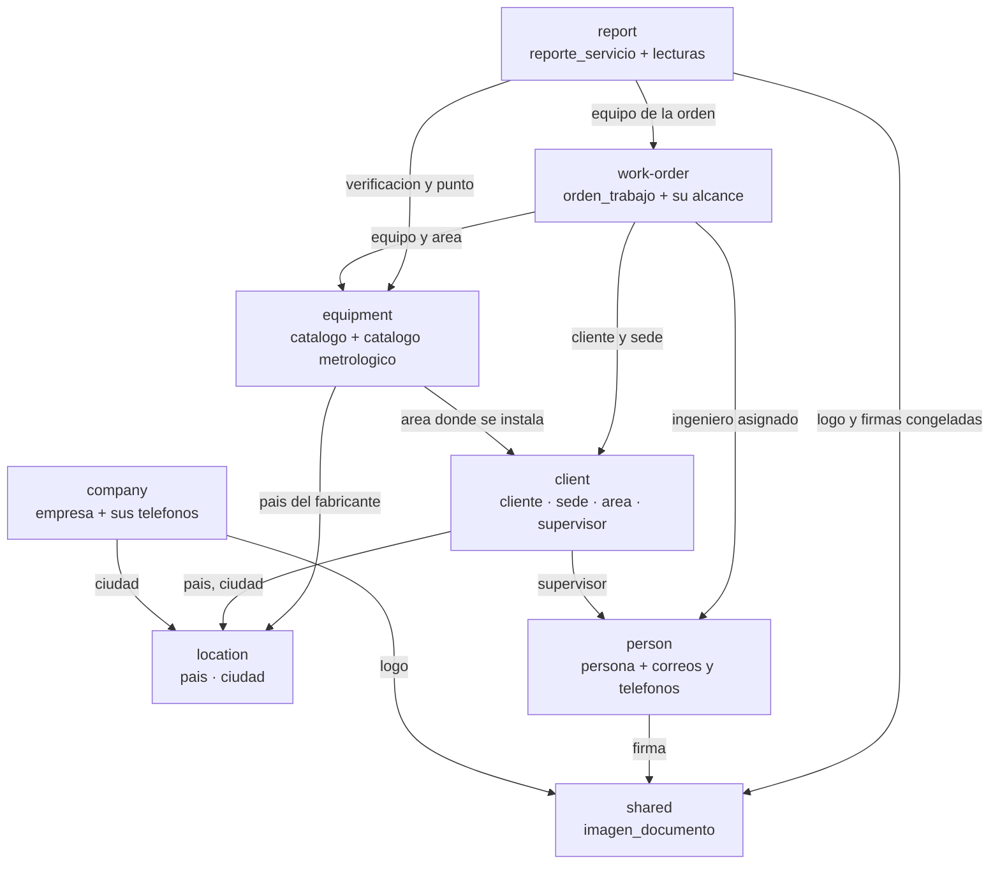

~~**Desde `V12` hay un par de módulos con referencias en los dos sentidos**~~, y era el único: `report`
apunta a `equipment` —la verificación y el punto de cada lectura— y `equipment` apuntaba a `report`
—`intervencion` guardaba de qué reporte salió—. **Desde `V52` no queda ninguno**: el historial se deriva
de los reportes y `equipment` lo pide por un puerto que contesta `report`. Lo que sigue es cómo era. **El código no tiene ese ciclo**, y a propósito:
`InterventionEntity` guarda el identificador del reporte como un UUID suelto, sin `@ManyToOne`, y el
oyente que la escribe vive en `report` y entra por un puerto que `equipment` publica. El ciclo existe
solo en la base, donde la foránea es lo que garantiza que una línea del historial no apunte a un reporte
inexistente. Quitarla rompería el ciclo y perdería esa garantía. Ver [[hoja-de-vida]].

## `company` — 2 tablas

La empresa que presta el servicio, que es el membrete de los documentos (`V36`). **Una sola fila**: lo
impone `b_unica`, siempre verdadera y única. Desde `V44` apunta a `location` por su ciudad; nadie la
apunta a ella: el informe **copia** sus datos al congelarse, en su documento, con el nombre de la ciudad y
no su identificador.

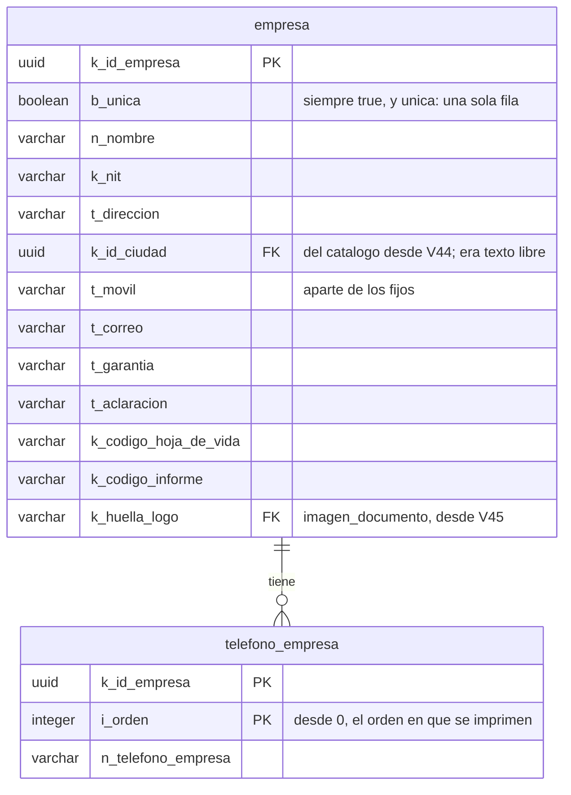

**`telefono_empresa` es una lista de valores, no una tabla de entidades** (`V43`): el formulario manda la
lista entera, así que la llave es (empresa, posición) y no lleva identificador ni borrado lógico. Hasta
`V43` era un arreglo en `empresa.t_telefonos`.

## `shared` — 1 tabla

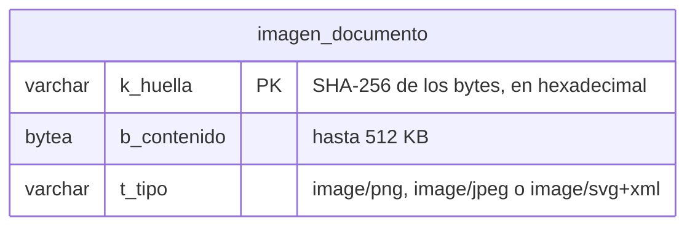

**El almacén de imágenes**, una vez por versión y por su huella: el logo de la empresa, la firma de cada
persona, y lo que un informe congela —el logo, la firma del ingeniero y la de quien recibe—. Nació en
`V37` para los logos de los informes, se renombró en `V38` al llegar las firmas, y **desde `V45` es de
todos**: la empresa y la firma de una persona lo apuntan, y en el código se movió del módulo `report` a
`shared`, porque `company` y `person` no pueden depender de `report`. **Una imagen no se borra nunca**:
cambiar de logo deja la anterior, que un informe congelado puede estar apuntando.

## `location` — 2 tablas

Datos de referencia. Los siembra `V7`: 249 países de la ISO 3166-1 y 1.350 ciudades. **No hay pantalla
que los cree**, y es deliberado: son lo primero que una instalación nueva necesita.

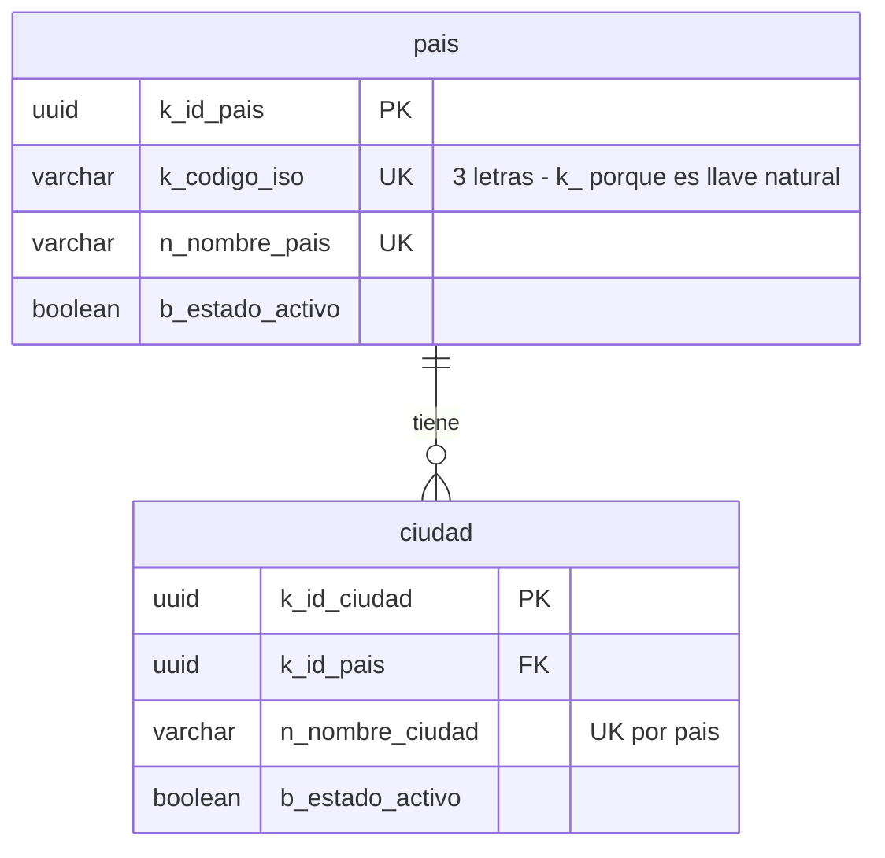

**Defecto conocido**: a `ciudad` le falta un nivel de división administrativa. 64 nombres de municipio
se repiten entre departamentos colombianos —cuatro La Unión, cuatro Villanueva, cuatro Buenavista— y
`UQ_ciudad_nombre_por_pais` los haría imposibles.

> **Matizado el 2026-10-04, porque esta frase engañaba.** Decía que el índice «los hace imposibles» y
> ahí se cortaba, de modo que un lector concluye que esos 64 municipios **no se pueden registrar**. No
> es así: `V7` los desambigua metiendo el departamento en el nombre —`La Unión (Nariño)`— y **los 1.103
> municipios están sembrados**, comprobado contra la base. Lo que queda es deuda de modelo y no un
> hueco de datos: el nombre carga con información que debería ser una columna, y ordenar o buscar por
> departamento sigue siendo imposible. La fila completa, en [[deuda-tecnica-y-riesgos]].
>
> Se corrige dejando constancia porque **el resumen truncado llegó a inducir el error**: en esta misma
> sesión se dio por hecho, citando esta línea, que había 64 municipios que no se podían dar de alta.

Ver [[dominio-ubicacion]].

## `person` — 4 tablas

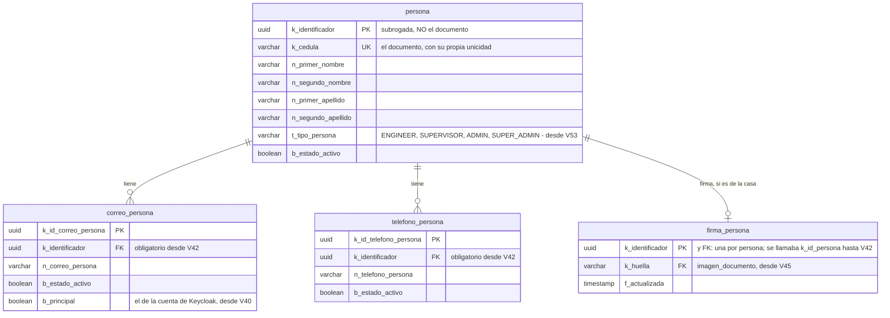

**`firma_persona`** (`V38`) es la firma de un ingeniero o un administrador, dibujada una vez: cada
informe que cierra la copia. No lleva borrado lógico, porque guardar otra la sustituye. Desde `V45` la
imagen vive en `imagen_documento` y la fila guarda su huella.

~~**Una deuda propia vive aquí**: el dueño es **anulable** en las dos tablas hijas —al contrario que en
los contactos del cliente—, y corregirlo exige su propia migración.~~ **Cerrada el 2026-10-27 por
`V42`**, que lo hace obligatorio; en desarrollo no había ninguna fila sin dueño. (Eran **dos** hasta el
**2026-10-17**: la otra era que **ningún correo estaba marcado como principal**, y la cerró `V40` con
`b_principal`, un `CHECK` que impide un principal retirado y una **restricción de exclusión diferida**
que deja uno solo por persona —ver la sección de los índices parciales para por qué no es un índice—.
El valor no lo rellena la migración sino un conciliador al arrancar, que le pregunta a Keycloak.)

## `client` — 6 tablas

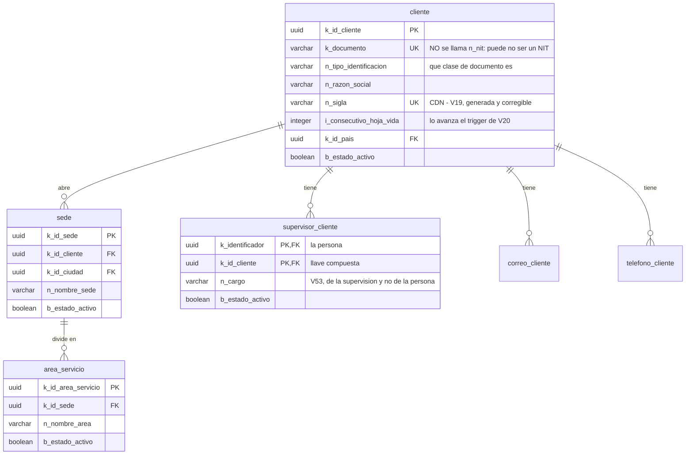

**Desde `V53`, el 2026-11-01, la gente del cliente es una: su supervisor.** `representante_legal` se
renombró a `supervisor_cliente` —sus filas no se copiaron, la tabla es la misma— y ganó `n_cargo`;
`encargado_sede` y `encargado_area` se borraron sin migrar sus filas, decidido por el usuario. El
supervisor tiene cuenta, ve lo de los clientes que supervisa y aprueba sus órdenes en todas sus sedes. El
cargo va aquí y no en `persona` porque depende de los dos lados. Ver [[decisiones-tecnicas-malphasos]].

**Lo que el esquema no comprueba, y vive en el servicio**: que la persona nombrada sea de tipo
`SUPERVISOR`. Una persona puede supervisar a varios clientes, y el esquema lo permite desde siempre.

> **Lo que había antes, para leer el historial.** Entre `V41` y `V53` un encargado respondía por varias
> sedes y áreas, con una tabla puente por cada una, y `V41` fue la primera migración con una prueba que
> migra hasta una versión: `ManagerAssignmentsMigrationTest`, que sigue en la batería porque prueba
> `V41` sobre un esquema aparte.

## `equipment` — 13 tablas

**Desde `V21` son cuatro cosas, y desde `V25` cinco**: lo de abajo, los **protocolos de mantenimiento**
de su propia sección y el **catálogo de equipos patrón**, al final. Son tres cosas en un módulo: la **cadena del catálogo** (seis tablas), el **catálogo metrológico con lo
que se verifica** (cuatro, de `V8` y `V10`) y, de `V12` a `V52`, el **historial de intervenciones** de
cada equipo instalado, que era la única sección de su hoja de vida con tabla propia. Desde `V52` no tiene
tabla: sale de los reportes cerrados del equipo. Ver [[hoja-de-vida]].

**«Equipo» significa dos cosas**, y es la trampa de este módulo: `equipo` es una **categoría** —la
combinación de una marca y un tipo— y `equipo_cliente` es la **máquina** instalada en un área.

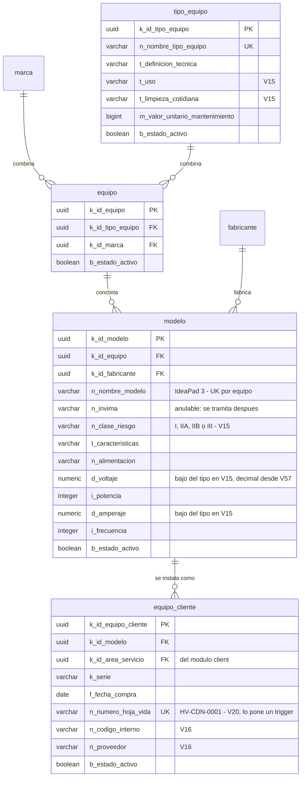

**`modelo` tiene nombre desde `V11`**, y hasta entonces no lo tenía: lo único legible que llevaba era
su registro INVIMA, que es un número de trámite **y es anulable**, de modo que cabía un modelo sin nada
que escribir en una fila. El nombre es obligatorio y **único por `equipo`** —«Serie 3» puede ser de dos
marcas distintas, y la marca vive en `equipo`—, con índice parcial como el resto.

**`tipo_equipo` ya no dice cómo se verifica**: hasta el 2026-10-03 tenía `b_verificable`,
`n_tipo_verificacion` e `i_cantidad_datos`, y las tres se fueron en `V10`. El booleano era exactamente
«hay modalidad» —redundante por construcción— y las otras dos no pueden ser del tipo, porque valen
distinto según la magnitud.

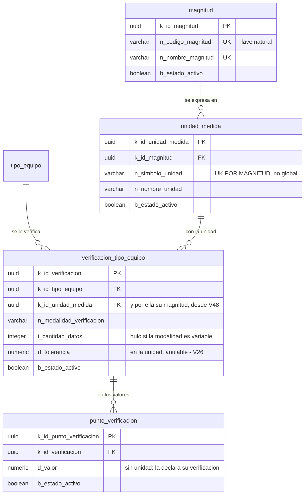

**Un tipo se verifica en varias magnitudes**, y es la corrección del 2026-10-03: un termohigrómetro
mide temperatura **y** humedad relativa, con unidades, puntos y modalidades distintas. Con el modelo
anterior había que registrarlo como dos tipos de equipo. Las 20 magnitudes y 46 unidades las siembra
`V10` y **no hay pantalla que las administre**, igual que los países. Ver
[[dominio-equipo-mantenimiento]].

**Cada verificación lleva su tolerancia desde `V26`** (2026-10-14), en su unidad —±0,5 °C—, y
**anulable**: los tipos anteriores no la tienen, y sin ella la conformidad de una lectura dice «sin
tolerancia» en lugar de inventarse una. Pero la regla de conformidad **no vive aquí**: la lectura del
reporte copia la tolerancia al tomarse, por la misma razón que copia la unidad. Ver el apartado de
`report`.

### Los equipos patrón — 1 tabla, desde `V25`

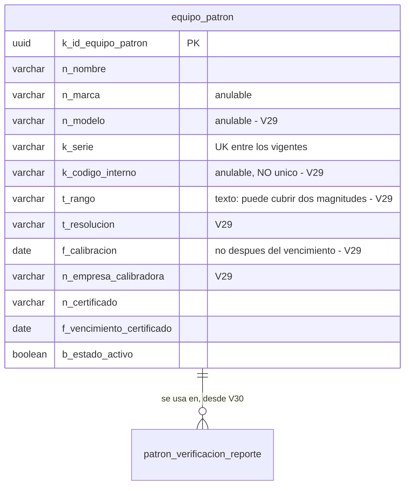

Los aparatos de referencia **de la empresa**, contra los que se toman las lecturas. **No son
`equipo_cliente`**: no se instalan en un área de ningún cliente ni tienen hoja de vida, y mezclarlos
habría hecho de cada patrón una máquina de un cliente ficticio. El vencimiento del certificado es la
fecha que RF-40 y RF-41 necesitan; **quién la vigila sigue sin existir**. Ver
[[dominio-equipo-mantenimiento]].

**Desde `V29` lleva la ficha que el informe imprime** en su tabla de trazabilidad, toda opcional: los
patrones ya registrados no la tienen y uno hecho en casa no tiene modelo ni empresa calibradora. **El
código interno no es único**, y es una pregunta abierta y no una decisión: la serie ya lo es entre los
vigentes, y nadie ha dicho si el código de inventario puede repetirse. Ver [[deuda-tecnica-y-riesgos]].

### Los protocolos de mantenimiento — 2 tablas, desde `V21`

Un protocolo es **una actividad reutilizable** —«Limpieza y desinfección»— que se escribe una vez y se
**asigna** a los tipos de equipo que la necesitan, con una **prioridad** que decide el usuario. Decidido
el 2026-10-10; ver [[hoja-de-ruta-producto]].

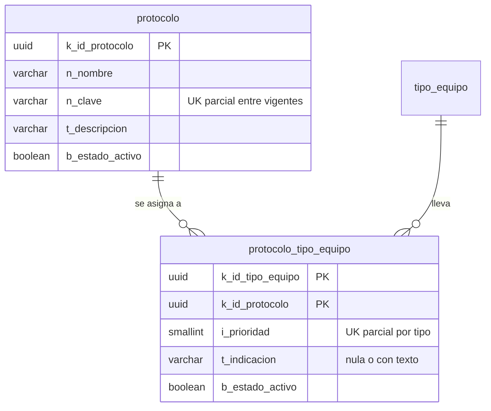

**Tres cosas que no se ven en el diagrama:**

- **`n_clave` es el nombre sin mayúsculas, sin tildes y con los espacios colapsados**, y es lo que no se
  repite. **La calcula la aplicación** (`Protocol.clave`) y no la base: `unaccent` no es `IMMUTABLE` y
  no puede ir en un índice. La base solo exige que esté en minúsculas.
- **La prioridad va seguida —1, 2, 3— y eso no lo garantiza el esquema**: el índice parcial impide las
  repetidas y el `CHECK` las no positivas, pero los huecos los evita la aplicación, que la **deriva de la
  posición** en la lista que recibe.
- **La tabla de unión se escribe con SQL y no con JPA.** Reordenar fila a fila choca a mitad de camino
  con su propio índice parcial —que no se puede diferir—, así que se retiran todas las filas vigentes
  del tipo y se reactivan con su prioridad nueva, en la misma transacción. Es la tercera vez que un
  índice parcial obliga a imponer el orden en el adaptador.

## `work-order` — 2 tablas

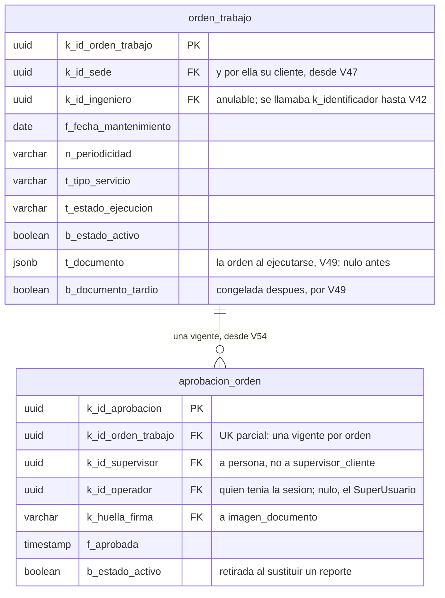

**Desde `V54`, el 2026-11-01, una orden ejecutada se aprueba**, que es lo que permite facturarla. La
aprueba un supervisor de su cliente, en sitio —dibujando su firma en la sesión del ingeniero— o desde su
cuenta con la firma guardada. **No se copia nada**: el nombre está en `persona`, el cargo en
`supervisor_cliente` y la forma se deduce comparando operador y supervisor. La foránea del supervisor va
a `persona` y no a `supervisor_cliente` para que la aprobación siga valiendo si después lo relevan; que
lo fuera **al aprobar** lo comprueba el servicio. Ver [[dominio-orden-trabajo]].

**Sus equipos no tienen tabla desde `V50`**: un equipo está en una orden si y solo si tiene en ella un
reporte activo, y el reporte apunta a la orden y al equipo. Hasta entonces los guardaba
`orden_trabajo_equipo`, identificada por el par y con el área en que estaba cada equipo al seleccionarlo;
el área la guarda ahora el documento de la orden al ejecutarse, y mientras no se ejecuta sus equipos no se
trasladan —regla del servicio—.

## `report` — 5 tablas

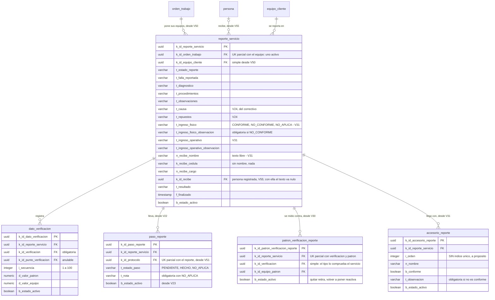

**Ninguna fila del reporte copia el catálogo desde `V51`.** Hasta entonces la unidad de una lectura, su
tolerancia, la ficha de cada patrón y el texto y la posición de cada paso eran copias congeladas en las
filas, para que reconfigurar un tipo o renovar un certificado no cambiara un reporte ya firmado. Eso lo
garantiza ahora el documento del reporte, que lo guarda al cerrar —ver [[dominio-reporte-servicio]]—, y
mientras es borrador se lee en vivo: una sola fuente para cada momento. El patrón conserva su
identificador con una foránea **simple** —un patrón nunca se borra—, que es lo que contesta con un join
«¿en qué reportes se usó?». (Esta nota decía que esas copias eran deliberadas: cierto hasta `V51`. Ver
[[congelar-una-referencia-historica]] para la decisión de entonces.)

> **Corregido el 2026-10-16, por la noche.** Este párrafo seguía: «y un `CHECK` de **todo o nada**: sin
> identificador no hay copia». **Falso desde `V30`**, el mismo día: un reporte no tiene ya un patrón
> sino **varios por cada verificación**, y las columnas de `V27` salieron de `reporte_servicio` hacia
> `patron_verificacion_reporte`, con la ficha entera de `V29` copiada. La copia sigue siendo copia y la
> foránea sigue siendo simple; lo que cambió es dónde viven.

**Quién recibe el equipo es texto y no una foránea a `persona`**, decidido por el usuario: muchas veces
es la jefa de enfermería de turno, que no está registrada. Y **las dos verificaciones al ingreso son
columnas fijas**, no filas, porque todo reporte las lleva —estructura física y estado operativo—; lo que
es lista libre son los accesorios.

**Los pasos del protocolo también son una copia**, por lo mismo: nombre, descripción e indicación son
los del día en que se abrió el reporte. Pero aquí **sí** hay foránea al protocolo, y no contradice lo
anterior: un protocolo nunca se borra, solo se retira, así que la foránea dice de cuál salió el paso sin
congelar nada. Ver [[dominio-reporte-servicio]].

## La foránea compuesta, que es una regla y no un adorno

Una foránea compuesta impone en el esquema algo que con dos foráneas sueltas quedaría abierto. Queda
una, y tapa un estado que de otro modo se podría escribir. (Eran **dos** hasta `V50`, el 2026-10-28: la
del reporte contra el puente impedía un reporte de un equipo que la orden no incluyó, y salió con el
puente: desde entonces es el reporte el que incluye al equipo, y que sea de la sede de la orden lo
comprueba el servicio al añadirlo.) (Eran **cuatro** hasta `V47`, el
2026-10-28: la de la orden con su cliente impedía una orden en una sede de otro cliente, y dejó de hacer
falta cuando la orden dejó de guardar su cliente —ya no hay dos datos que puedan contradecirse—. Y
**tres** hasta `V48`, ese mismo día: la de la verificación con su magnitud impedía medir temperatura en
%HR, y salió por lo mismo: la verificación guarda solo la unidad, y la magnitud es la suya.)

| Tabla | El par | Lo que impide |
|---|---|---|
| `dato_verificacion` | (verificación, punto) → `punto_verificacion` | Una lectura en un punto **de otra verificación** |

**Y admite el caso nulo sin una regla extra**: una foránea compuesta con alguna columna
nula **no se comprueba** —es `MATCH SIMPLE`, lo que PostgreSQL hace por omisión—, de modo que la
lectura sin punto pasa y la que trae punto queda atada.

## Los 10 índices únicos parciales, y por qué son parciales

`UQ_reporte_servicio_activo`, `UQ_punto_verificacion_activo`, `UQ_dato_verificacion_activo`, desde `V11`
`UQ_modelo_nombre_activo_por_equipo`, desde `V21` `UQ_protocolo_clave_activo` y
`UQ_protocolo_tipo_equipo_prioridad_activa`, desde `V25` `UQ_equipo_patron_serie_activo`, desde `V30`
`UQ_patron_verificacion_reporte_activo`, desde `V35` `UQ_equipo_patron_codigo_interno_activo` y desde
`V51` `UQ_paso_reporte_protocolo` —un reporte no repite protocolo—.
(Decía **cinco**: cierto hasta el **2026-10-10**; **siete** hasta el **2026-10-14**, y **ocho** hasta el
**2026-10-16**. **Corregido el 2026-10-28**: la lista nombraba nueve y no traía el de `V35`, de modo que
eran diez desde el 2026-10-17, como ya decía la tabla de cifras. Vuelven a ser nueve con `V48`, que quitó
`UQ_verificacion_magnitud_activa_por_tipo` con la magnitud de la verificación: esa regla vive ahora solo
en el agregado. Y diez otra vez con `V51`.) **`UQ_reporte_servicio_numero`, de `V28`,
no está en la lista y no es un olvido**: es único y no parcial, porque un número impreso no se recicla.
Los nueve llevan `WHERE b_estado_activo`, y la razón es la misma
en todos: **aquí nada se borra**. Una restricción normal impediría volver a dar de alta algo que se
retiró, de modo que reconfigurar hacia atrás sería imposible.

**Y cobran un precio**: Hibernate vacía los `INSERT` antes que los `UPDATE`, así que
sustituir una fila activa por otra equivalente choca contra el índice. Un índice **parcial** no se
puede declarar diferido —`DEFERRABLE` es de las restricciones, y una restricción `UNIQUE` no admite
`WHERE`—, así que el orden se impone en el adaptador con un `saveAndFlush` intermedio —o, en la asignación de
protocolos del 2026-10-10, con SQL en dos pasos—. Lo pagaron dos módulos:
`report` el 2026-09-27 y `equipment` el 2026-10-03, donde llevaba **latente** porque ninguna prueba lo
ejercía. Ver [[stack-spring-boot-4-particularidades]].

**Corregido el 2026-10-17: había una salida que esta nota no veía.** Decía que «una restricción no
admite `WHERE`», y eso es cierto de `UNIQUE` pero **no de `EXCLUDE`**: una restricción de exclusión
admite `WHERE` **y** `DEFERRABLE INITIALLY DEFERRED`, y con `USING btree (col WITH =)` dice lo mismo que
un índice único parcial. `V40` la usa para el correo principal —`EX_correo_principal_por_persona`—,
porque cambiar de principal son dos `UPDATE` en el mismo flush y Hibernate no garantiza su orden: diferida,
se comprueba al confirmar. **Hay una prueba que lo demuestra quitando el `DEFERRABLE`**, y su primera
versión no lo demostraba: con el correo nuevo detrás en la lista Hibernate actualizaba primero el viejo y
pasaba igual sin diferir. Los nueve índices de arriba podrían migrarse a esta forma; no se ha hecho.

**Y otra corrección del mismo día**, que el guion de esta nota cazó al volver a pasarlo: el diagrama de
`equipment` seguía dibujando `tipo_equipo.t_formato_reporte`, que `V33` retiró el 2026-10-16 al
abandonar los formatos `MPx`. Llevaba un día caducada, y nadie había vuelto a correr el guion.

## Lo que el esquema **no** dice

Veinte reglas de negocio no están aquí y viven en los servicios, y no por descuido: el esquema no
puede expresarlas. «No abrir un área en una sede cerrada» exige mirar otra fila; «el punto pertenece al
tipo del equipo reportado» son cuatro saltos desde `equipo_cliente`. Y hay una tercera categoría: una
restricción que el esquema **podría** expresar y que **no debe**, porque congelaría el otro lado — ver
[[congelar-una-referencia-historica]].

## Lo que falta

- ~~**El vencimiento de calibración** no tiene columna~~. **Falso desde `V25`** (2026-10-14): RF-40 y
  RF-41 hablan del vencimiento de los **equipos patrón**, y `equipo_patron.f_vencimiento_certificado` es
  esa fecha. Lo que falta ya no es una columna sino **quién la vigile**: no hay tareas programadas en el
  backend, y la única que la lee es la pantalla del catálogo de patrones y el cierre de un reporte.
- **El filtrado por dueño no necesitó ninguna columna nueva**, y esta línea decía lo contrario. Decía
  que «no existe: ninguna tabla lleva columna de pertenencia que el API use para recortar lo que un
  usuario ve». **Construido el 2026-10-04 sin migración**: la pertenencia ya estaba, repartida entre
  `representante_legal` —cuya llave compuesta permite que una persona represente a varios clientes— y
  el hecho de que `persona.k_identificador` **es** el identificador que asigna Keycloak. Lo que el
  esquema no tiene, y sigue sin tener, es una columna que lo diga en un solo sitio: el camino del dato
  al dueño son hasta tres saltos y los recorre la capa de aplicación. Ver [[filtrado-por-dueno]].
- **La firma digital** no tiene tablas todavía. (Esta línea decía también «la hoja de vida como entidad»: **la hoja de vida no es una entidad** y no tiene tabla; lo que sí la tiene desde `V12` es su historial, `intervencion`. Ver [[hoja-de-vida]].)
